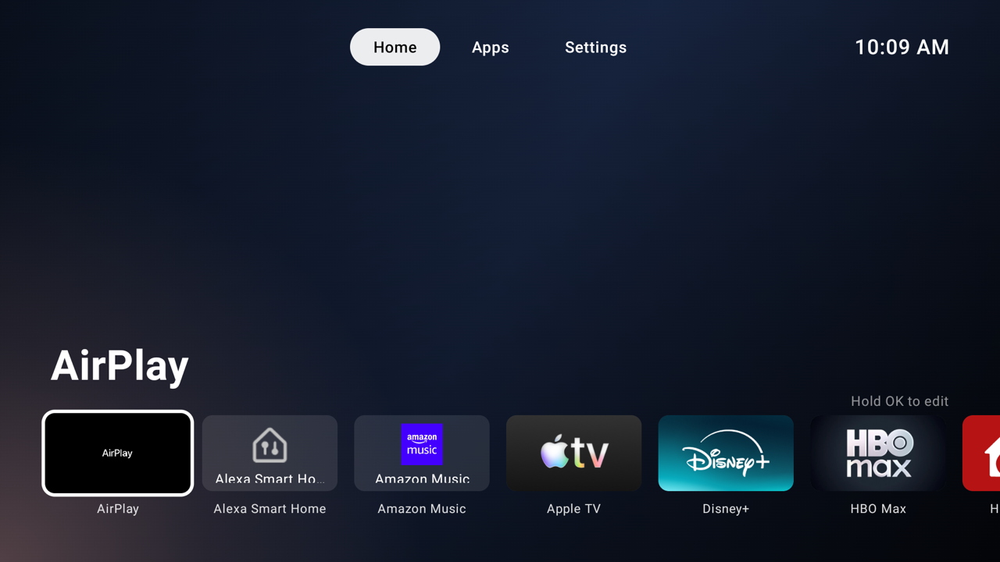
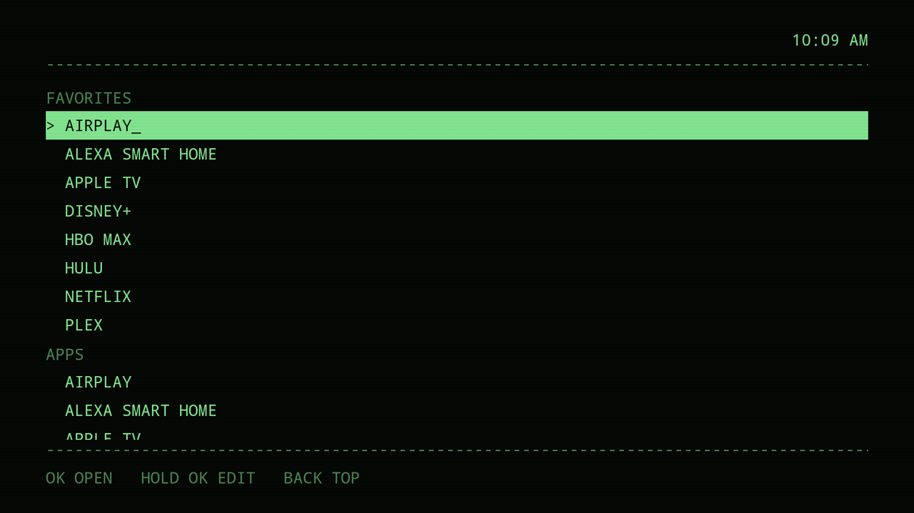
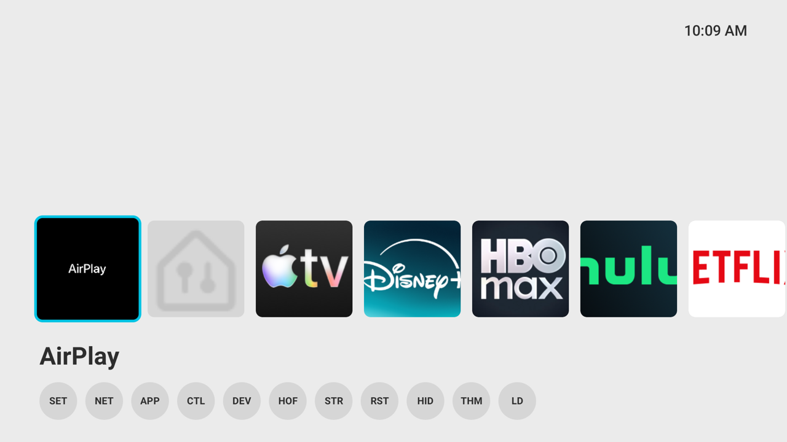
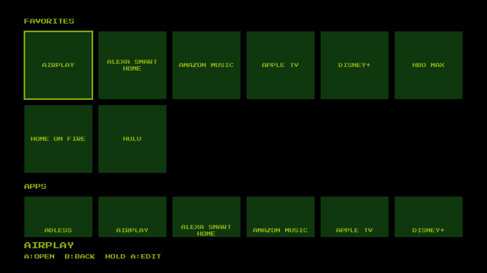
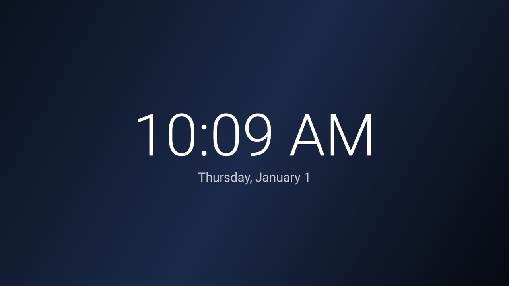
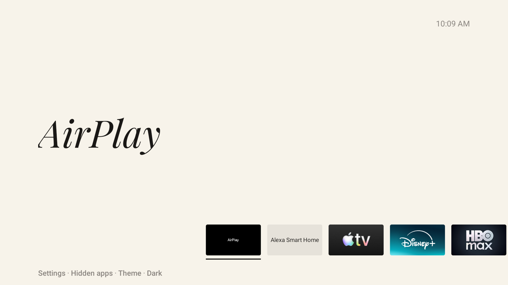

# firetv-adless

A replacement home screen for Amazon Fire TV with no ads, sponsored rows, or autoplaying trailers: your apps and nothing else.

## Supported devices

Tested on a TCL Fire TV (AFTDEC012E) running Fire OS 8.1.8.5 (Android 11).
Any Fire OS 6, 7 or 8 device should work.

## Install

On a Mac, open Terminal and run:

```bash
git clone https://github.com/smithbr/firetv-adless.git
firetv-adless/tools/setup.sh
```

If macOS offers to install the command line developer tools, accept, then
run the first line again.

`setup.sh` installs [Homebrew](https://brew.sh) if it is missing, then
`adb` from the [Brewfile](Brewfile), asking first, and offers to put
Homebrew and the `firetv` command on PATH in your shell profile. While
this repo is private, it also installs GitHub's `gh` and signs you in, which
downloading the launcher needs. On Linux it lists what to install instead.
It ends by offering to set up the TV, which runs `firetv setup`:

1. It shows what to turn on with the remote: Developer options, ADB
   debugging and Apps from Unknown Sources.
2. It asks for the TV's IP and remembers it, then waits while you accept
   the debugging prompt on the TV.
3. It downloads the launcher from the
   [latest release](../../releases/latest), installs it and makes it Home,
   then tunes the TV and runs Doctor, in that order. Installing asks
   before replacing a launcher that is already there, and the other steps
   ask before changing anything.

Run `firetv setup` again any time, or `firetv` for the menu. To use a
different TV for one command, set `FIRETV_HOST` to its IP. The IP is
saved in `~/.config/firetv/host`; if the TV's IP changes, run
`firetv setup` and answer No to "Use the TV at …?".

### Updating

When a newer release is out, `firetv` says so as it opens and offers to
install it; `firetv install` (or install in the menu) does the same. A
launcher installed from v0.2 or earlier, or built on another computer, is
signed with a different key, so updating replaces it; that clears its
favorites and hidden apps, and `firetv` says so before it starts. The theme
is put back, or asked for when the old launcher is too old to report it.

### Make it Home

Part of install: once the launcher is on the TV, install makes it Home, in
the walkthrough or with `firetv install`. It asks before changing anything.
Until it's Home, open the launcher from Your Apps on Amazon's home screen.

**Before Fire OS 8.1.6.9** it disables Amazon's launcher and sets this one as
Home. Settings sections still open from the Settings row, but the full
Settings menu is gone.

**Fire OS 8.1.6.9 and later** block replacing Amazon's launcher without
root, so the step changes nothing and offers
[Home on Fire](https://github.com/toolicious/home-on-fire) (GPL-3.0): an
accessibility service that opens this launcher at boot and whenever Amazon's home
appears. Accept it, then on the TV select **Choose target app…** and pick
`Launcher`.

Home then reaches this launcher after about 2.5 s (4 to 5 s after a reboot), with
Amazon's home showing meanwhile. Long-press and double-press Home still go
to Amazon's home unless you turn them off in Home on Fire.

### Debloat

Part of tune, in the walkthrough or with `firetv tune`: one checklist of
the ad, recommendation and telemetry packages in
`tools/packages-disabled.txt` and the settings tweaks in `tools/tweaks.txt`.
The ticks show the TV as it is: a ticked package is disabled, a ticked tweak
is on. Enabled packages are listed first. Tick a package to disable it, untick
it to turn it back on; ctrl+a ticks them all. Some Fire OS versions protect a
package from being disabled; tune says so, leaves it on, and stops offering it.

The packages the TV needs, listed in `tools/packages-core.txt` (Amazon's
launcher, Settings, the Appstore, OTA updates, sign-in, the screensaver, the
TV tuner and a few they depend on), are never disabled.

### Look after the TV

Every menu entry is also a command, with the same name: `firetv doctor`
runs what doctor in the menu runs. `firetv --help` lists them all.

```bash
firetv doctor                      # check the connection, the launcher's version and key, core packages, debloat and storage; changes nothing
firetv install                     # install or update the launcher, remove old builds, make it Home
firetv tune                        # checklist in a terminal, tweak list elsewhere
firetv tune fast-animations on     # turning one off restores the old values
firetv clean                       # trim app caches, then remove old launcher builds, asking first
firetv reboot
```

Old launcher builds are earlier names and debug or devicetest builds,
listed in `tools/packages-old-launchers.txt`. Each shows as a blank tile in
Apps; doctor warns about them, and install and clean offer to remove them.

### Apps

`firetv apps` gets apps from Amazon's Appstore, sideloads an APK, or
uninstalls apps. From the command line:

```bash
firetv apps list                   # what's installed, and from where
firetv apps add netflix            # a name from tools/appstore.txt
firetv apps add tv.pluto.android   # or a package, ASIN or amazon.com link
firetv apps remove netflix
firetv apps remove                 # a checklist of what's installed
```

`add` opens the app's Appstore page on the TV and presses OK only for a free
**Get** or **Download**. For a price or a subscription it leaves the page open
for you to decide on the TV.

## Themes

Pick one from the Theme tile in Settings. Each is described in
[docs/themes.md](docs/themes.md).

<!-- screenshots -->

|                                                                    |                                                              |
| ------------------------------------------------------------------ | ------------------------------------------------------------ |
| <br>Dapple TV          | <br>Terminal       |
| <br>Mintendo Snitch | <br>Game Queen |
| <br>Ambient clock    | <br>Editorial    |

<!-- /screenshots -->

## Using it

In the default Dapple TV theme, three tabs run across the top: **Home**
(your favorites), **Apps** (everything installed, sideloaded apps
included) and **Settings** (Fire TV's settings sections, the Appstore,
Restart and Hidden apps).

- Hold OK on any app to favorite, hide or uninstall it. Built-in Amazon
  apps can only be hidden; Settings > Hidden apps brings them back.
- **Restart** in Settings restarts the TV at once. It goes through the
  TV's own adb, so ADB debugging must stay on. The first time, the TV asks
  to allow the launcher; tick Always allow and it never asks again.
- **Backdrop** in Settings picks **Still** (your photo, or a dark
  gradient) or **App banners** (the focused favorite's banner, blurred;
  heavier on the GPU).

To use your own photo, push it and restart the app, with `FIRETV_HOST`
set to the TV's IP and port (`export FIRETV_HOST=192.168.1.20:5555`):

```bash
adb -s "$FIRETV_HOST" push backdrop.jpg /sdcard/Android/data/la.bsmith.launcher/files/backdrop.jpg
adb -s "$FIRETV_HOST" shell am force-stop la.bsmith.launcher && adb -s "$FIRETV_HOST" shell am start -n la.bsmith.launcher/.MainActivity
```

## Develop

`tools/setup.sh --build` adds [Temurin](https://adoptium.net) and the
Android SDK, accepts the SDK licenses and points the build at the SDK. On
Linux, install Temurin 17 to 27 and Android's command-line tools and set
`ANDROID_HOME` to the SDK first. Install then offers **Build it here**,
which runs `tools/install.sh --launch`. In
[Android Studio](https://developer.android.com/studio), set the build
variant to `release` and press Run.

**Signing:** releases are signed with a key kept outside the repo, so each
one updates the last in place. `tools/release-key.sh` creates it in
`~/.android` and points Gradle at it; back up the keystore and its
password, since a lost key means users must reinstall. Its certificate's
SHA-256 is pinned in `app/release-key.sha256`: the script refuses to make
or upload a key that does not match unless given `--rotate`. Without the
key, release builds use the debug key and cannot update an installed
release.

**Releasing:** bump `versionName` and `versionCode` in
`app/build.gradle.kts` and push to main. The Release workflow builds the
signed APK and publishes it as `launcher.apk` in a release named after the
version, listing the commits since the last one. It signs with the key in
the repo's Actions secrets, which `tools/release-key.sh --github` stores,
and refuses to publish an APK whose certificate does not match the pin.

## Undo everything

Run in this order:

```bash
adb uninstall io.github.toolicious.homeonfire   # if Home on Fire was installed
tools/restore-home.sh      # if make-home.sh was run: Amazon's launcher back as Home
tools/uninstall.sh         # remove this launcher from the TV
tools/restore-debloat.sh   # re-enable every disabled package
```

`firetv reset` runs the same steps, asking before each.

A factory reset (Settings > My Fire TV > Reset) also undoes all of it.
